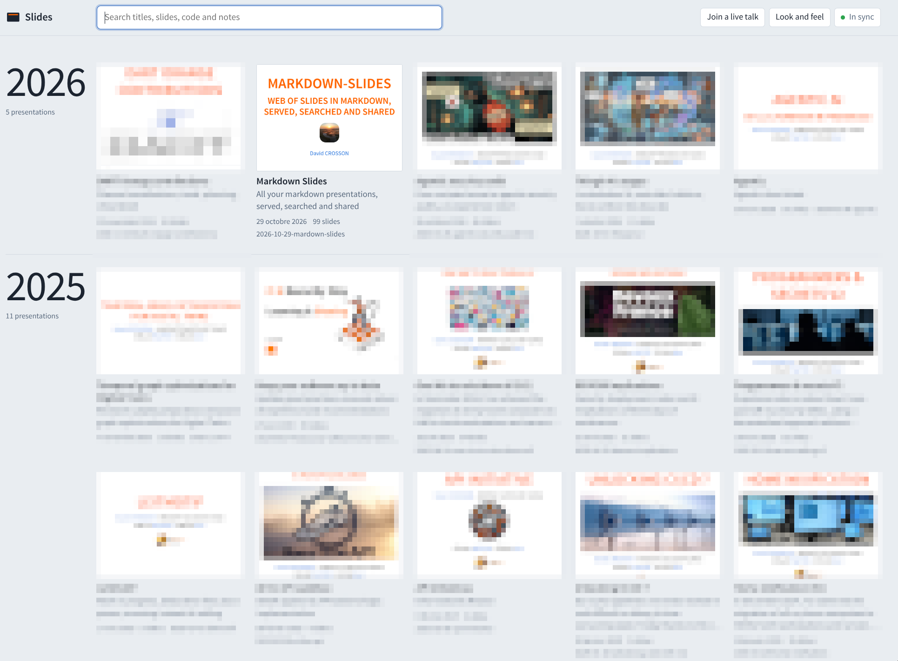

# markdown-slides

A local web application for presentations written in markdown, compatible with
[reveal-md](https://github.com/webpro/reveal-md) : it watches the presentation directories, lists every presentation
with its thumbnail, searches them by words and by meaning, plays them with a reveal.js like player and speaker view,
exports them as PDF, and lets participants follow a talk live from their own devices.



## Running

```bash
make run-examples # on the sample presentation (examples/), then browse http://127.0.0.1:8048/
make run          # from the sources, then browse http://127.0.0.1:8048/
make run-jar      # from the standalone jar : the build stays usable meanwhile (make test...)
make run-shared   # listening on every network interface, for participants to follow from their devices
```

The [flake](flake.nix) provides everything : java, mill, scala-cli, scalafmt, make, curl, jq, Chromium for the
thumbnails and the PDF exports, and troubleshooting tools (`mdb_stat`, `pdfinfo`, ImageMagick). With
[direnv](https://direnv.net/), it loads on entering the directory, then your own settings :

```bash
cp envrc.template .envrc.local   # personal settings, never committed
direnv allow                     # or : nix develop
make check-mill                  # the mill pinned in build.mill is the one of the flake
```

Without it, Java 21+, mill and, for the thumbnails and the PDF exports, Chrome or Chromium are needed. On Ubuntu
23.10+, AppArmor refuses their sandbox to the browsers it does not know, the one of the flake included : use the
Chrome of the distribution, `export MARKDOWN_SLIDES_BROWSER=google-chrome` in `.envrc.local`. The jar needs these JVM options
(the Makefile and `build.mill` pass them) :

```
--enable-native-access=ALL-UNNAMED --add-modules jdk.incubator.vector --add-opens java.base/java.nio=ALL-UNNAMED --add-opens java.base/sun.nio.ch=ALL-UNNAMED
```

`make run` keeps mill busy : another mill command (`make test`) waits for it to end. Use `make run-jar` while
developing.

## Configuration

Every setting of [application.conf](src/main/resources/application.conf) can be set by an environment variable :

| Variable                                  | Default                                  |                                                                    |
|-------------------------------------------|------------------------------------------|--------------------------------------------------------------------|
| `MARKDOWN_SLIDES_SOURCES`                 | `~/slides`                               | presentation directories, comma separated, git working trees or not |
| `MARKDOWN_SLIDES_THEME_DIRECTORIES`       |                                          | reveal.js themes (css files), comma separated, besides the built-in |
| `MARKDOWN_SLIDES_DEFAULT_THEME`           | `orange-white`                           | until another one is chosen from the user interface                 |
| `MARKDOWN_SLIDES_LISTEN_HOST`             | `127.0.0.1`                              | `0.0.0.0` : participants can join from other devices               |
| `MARKDOWN_SLIDES_LISTEN_PORT`             | `8048`                                   |                                                                    |
| `MARKDOWN_SLIDES_DATA_DIRECTORY`          | `~/.markdown-slides`                     | database, thumbnails, PDF exports                                   |
| `MARKDOWN_SLIDES_BROWSER`                 | `google-chrome`                          | headless browser drawing the thumbnails and printing the PDF        |
| `MARKDOWN_SLIDES_PDF_AUTHOR`              |                                          | written in the PDF exports                                          |
| `MARKDOWN_SLIDES_EMBEDDINGS_BASE_URL`     | `http://127.0.0.1:8081`                  | any OpenAI compatible embeddings server                             |
| `MARKDOWN_SLIDES_EMBEDDINGS_MODEL`        | `qwen3-embedding-0.6b`                   | empty : search by words only                                        |
| `MARKDOWN_SLIDES_EMBEDDINGS_API_KEY`      |                                          | when the embeddings server needs one                                |
| `MARKDOWN_SLIDES_EMBEDDINGS_USERNAME`     |                                          | basic authentication, used instead of the API key when given        |
| `MARKDOWN_SLIDES_EMBEDDINGS_PASSWORD`     |                                          | its password                                                        |

## Presentations

The [sample presentation](examples/2026-10-29-markdown-slides/index.md) shows every feature below : run it with
`make run-examples`, or see it [online](https://erahs.code-examples.org/p/01a1fed5-da45-7429-98b3-e2237da40deb#/0).

As with reveal-md, each markdown file is a deck ; the decks of a directory make a presentation, its `index.md` first,
the others listed with it. A presentation is dated by its directory name (`2024-02-reveals-md`), the `date:` of its
front matter, or its first commit.

- `---` alone on its line : the next slide ; `----` : the next slide below (vertical stacks). Unlike reveal-md, these
  lines are left alone within code blocks. The front matter `separator:` and `verticalSeparator:` change them.
- `Note:` starts the speaker notes of a slide.
- `<!-- .slide: data-background="#1c2430" class="x" -->` : attributes of the slide, backgrounds (colors, images,
  videos, frames) included ; `<!-- .element: class="fragment" -->` : attributes of the element before it.
- front matter : `title`, `description`, `theme`, `date`, `duration` (minutes, for the speaker view pace),
  `revealOptions.controls`, `revealOptions.progress`, `revealOptions.slideNumber`, `revealOptions.center`.

Markdown extensions :

| Syntax                                       | Shows                                                       |
|----------------------------------------------|-------------------------------------------------------------|
| ` ```scala ` , ` ```scala [2-4] `            | highlighted code (highlight.js), highlighted lines          |
| ` ```mermaid `                               | mermaid diagrams                                            |
| `$inline$`, `$$display$$`, ` ```math `       | maths (KaTeX)                                               |
| ` ```svg ` or inline `<svg>`                 | SVG pictures                                                |
| ` ```terminal title `                        | a terminal window, `$ ` and `# ` prompts highlighted        |
| `> [!NOTE]`, `[!TIP]`, `[!WARNING]`...       | callouts                                                    |
| `==marked==`, `:rocket:`, tables, task lists | marked text, emojis, GFM                                    |
| `- [ ]`, `- [x]`, `- [/]`                    | task lists, to do, done, in progress (as Obsidian)          |

Links to other decks (`[intro](introduction.md)`) open them in the player ; pictures are resolved against the deck
directory. As with reveal-md, headings are anchors : `[setup](#quick-setup)`, `[links](other.md#links)` open the slide
holding `### Quick setup`, `### links`. Frames, pictures and videos given a `data-src` load once their slide is shown.

## Using it

- **Library** : the presentations by year, with their thumbnails, titles and descriptions (front matter `title` and
  `description`) ; click one to play it, its toolbar gives the speaker view, going live and the PDF. Type `/` to search.
  Search results point at the matching slides.
- **Play** : `→ ←` `↓ ↑` slides, `space` next step (fragments), `Esc` overview, `F` full screen, `B` black screen,
  `Alt`/`Ctrl` click zoom, `?` all the keys. The URL follows the slide (`#/12/1`).
- **Present** : the slides in this tab and the speaker view in a new window (or `S` from the slides) : current slide,
  next step, notes, timers, the pace when the deck has a `duration`. Both windows stay in sync.
- **Go live** (`G`) : participants open the shown address, or type its code in *Join a live talk*, and follow the
  presenter ; they can browse on their own and come back. Listen on every interface (`make run-shared`) for other
  devices to join.
- **PDF** : printed on demand by the headless browser, every fragment shown, with the slides as bookmarks.
- **Look and feel** : the theme (built-in : `white`, `black`, `orange-white`, `orange-black`), and custom CSS applied over it.

Saving a markdown file, a picture or a theme updates the open views within seconds : the library, the slides, the
speaker view and the participants' screens.

## How it works

Everything runs in one Java process (Scala 3, ZIO, zio-http) :

1. **Scan** - every 2 seconds, the source directories are walked, skipping hidden directories and what `.gitignore`
   files ignore (JGit). New or changed decks are read : front matter, slides, notes, titles, plain text. The git
   history gives each deck its dates and commits.
2. **Store** - decks and their content are kept in an embedded database ([zio-lmdb](https://github.com/dacr/zio-lmdb)),
   the single source of truth ; the search index is rebuilt from it at each start.
3. **Index** - each slide is indexed by its words ([Lucene](https://lucene.apache.org/)), and by its meaning : an
   embedding per slide, computed by the embeddings server, stored with zio-lmdb-vector. A search runs both and merges
   their rankings by reciprocal rank fusion, words weighing more.
4. **Draw** - the headless browser draws a thumbnail of each deck from the pages of the application, so that they look
   exactly as shown, theme included ; PDF exports are printed the same way, then completed with PDFBox (information,
   bookmarks).
5. **Notify** - the views listen to server sent events : changed decks, pictures, themes, thumbnails, live
   presentations.

The browser libraries (marked, highlight.js, KaTeX, mermaid, the Source Sans Pro fonts) come from WebJars and are
served by the application : it works offline. The slides use the reveal.js DOM structure (`.reveal .slides section`),
so reveal.js themes apply as they are.

## License

markdown-slides is released under the [Apache License 2.0](LICENSE).

Third party works it includes or serves :

- the built-in themes (`src/main/resources/themes`) are derived from the [reveal.js](https://github.com/hakimel/reveal.js)
  themes, Copyright (C) Hakim El Hattab, under the [MIT license](https://github.com/hakimel/reveal.js/blob/master/LICENSE) ;
- the browser libraries come from [WebJars](https://www.webjars.org/), each under its own license :
  [marked](https://github.com/markedjs/marked) (MIT), [highlight.js](https://github.com/highlightjs/highlight.js)
  (BSD-3-Clause), [KaTeX](https://github.com/KaTeX/KaTeX) (MIT), [mermaid](https://github.com/mermaid-js/mermaid) (MIT),
  and the Source Sans Pro fonts bundled with reveal.js (SIL Open Font License 1.1).
