# markdown-slides
## Web of slides in markdown, served, searched and shared


[David CROSSON](https://github.com/dacr)

---

### introduction

- [markdown-slides](https://github.com/dacr/markdown-slides)
  + Still a very simple slides design
    * Focus only on content
    * Simple syntax : **Markdown**
  + [reveal-md](https://github.com/webpro/reveal-md) compatible
    * existing decks play as they are
  + Git compatible
    * slides content = raw text files
  + All your presentations == one web application

Note:
The 2024 talk was about reveal-md : one deck, one node process.
This one is about the tool built over it for all the decks.

---

### from reveal-md to markdown-slides

<div id="left">

#### reveal-md

- one deck at a time
- one node process per deck
- static export
- speaker view on the same computer

</div>
<div id="right">

#### markdown-slides

- Auto-index presentations
- 1 process, works offline
- Words **and** meaning search
- Participants follow on their own devices
- PDF on demand

</div>

---

### quick setup

```terminal setup
$ git clone git@github.com:dacr/markdown-slides.git
$ cd markdown-slides
$ make run
```

- Needs Java 21+, [mill](https://mill-build.org/)
  + and Chrome or Chromium for the thumbnails and the PDF
- browse to http://127.0.0.1:8048/
- `make help` lists all the commands

----

### configuration

Environment variables, or `application.conf` :

| Variable                              | Default                              |
|---------------------------------------|--------------------------------------|
| `MARKDOWN_SLIDES_SOURCES`             | `~/slides`                           |
| `MARKDOWN_SLIDES_THEME_DIRECTORIES`   | none, built-in themes only           |
| `MARKDOWN_SLIDES_DEFAULT_THEME`       | `orange-white`                       |
| `MARKDOWN_SLIDES_LISTEN_HOST`         | `127.0.0.1`                          |
| `MARKDOWN_SLIDES_EMBEDDINGS_BASE_URL` | any OpenAI compatible server         |

----

### presentations layout

```
slides/
├── 2024-02-reveals-md/
│   ├── index.md              ← the presentation
│   └── captures/tapir.jpg    ← its pictures
└── 2026-10-29-markdown-slides/
    ├── index.md
    └── extras.md             ← listed with it
```

- Each markdown file is a deck, `index.md` first
- Dated by its directory name, its `date:`, or its first commit
- `.gitignore` and hidden directories are respected

---

### how it works

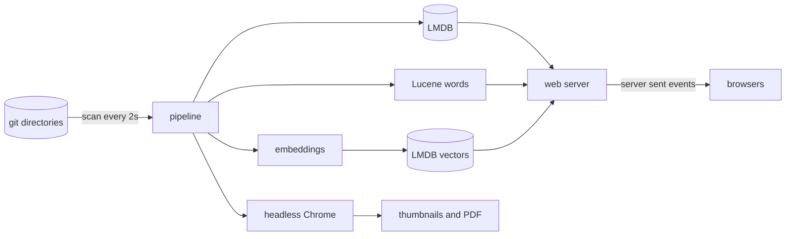

Note:
Scala 3, ZIO, zio-http, zio-lmdb as the single source of truth.
Saving a file updates every open view within seconds.

---

### the library

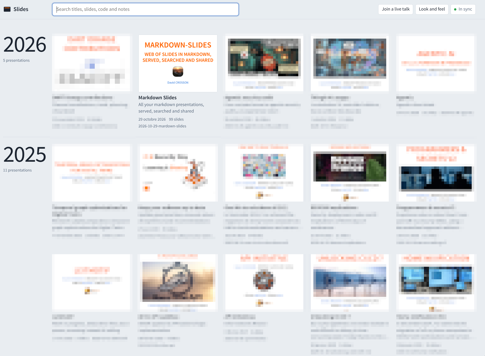<!-- .element: class="img" width="500px" -->

- Presentations by year
  - thumbnails drawn with your theme
- Changes are live updated

---

### search

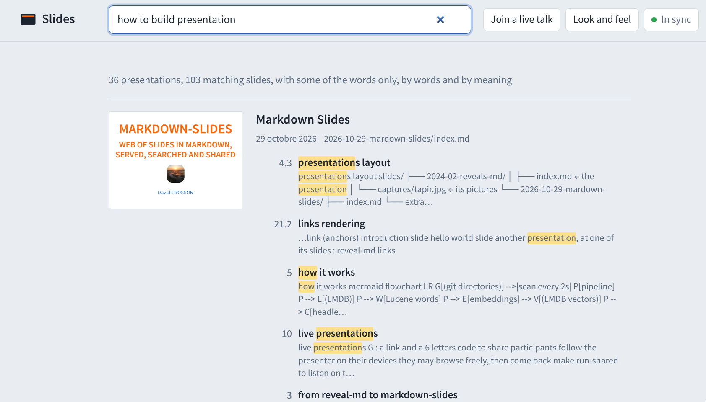<!-- .element: class="img" width="480px" -->

- `/` to search, results open the matching slide
- by words : accents and case ignored, the last word completed
- by meaning : an embedding per slide
- both merged by reciprocal rank fusion

----

### search by meaning

- Embeddings computed by any OpenAI compatible server
  + `qwen3-embedding-0.6b` here, 1024 dimensions
  + stored with [zio-lmdb-vector](https://github.com/dacr/zio-lmdb)
- Ask for an idea, not for its words
  + *"how to keep dependencies up to date"* finds renovate
- No server ? search by words only

---

### Keys

- `→` `←` `↓` `↑` or `h` `l` `j` `k` : Move right, left, down, up
- `space` `PageDown` `n` : Next step, `shift+space` `p` : back
- `Home` / `End` : First / last slide
- `ESC` or `o` : Show/hide slides map
- `Alt` or `Ctrl` + `Click-Left` : ZoomIn/zoomOut on a slide part
- `S` : Speaker view, `G` : Go live
- `F` : Full screen, `B` or `.` : Black screen
- `?` : View all keyboard shortcuts

---

### speaker view

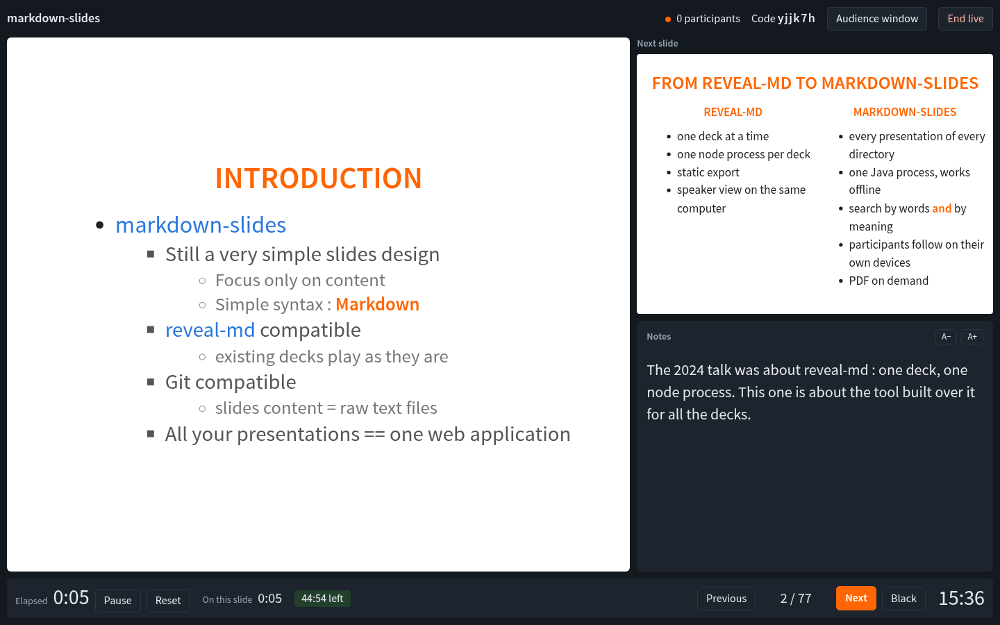<!-- .element: class="img" width="620px" -->

- `S` or the *Present* button : slides here, speaker view there
- current slide, next step, notes, timers, pace

----

### speaker notes

```markdown
### My slide

- only this on the screen

Note: only in the speaker view,
**markdown** included
```

----

### talk duration

```markdown
---
title: markdown-slides
duration: 45
---
```

- The speaker view tells if you are ahead or late
  + compared to the slides already shown

---

### live presentations

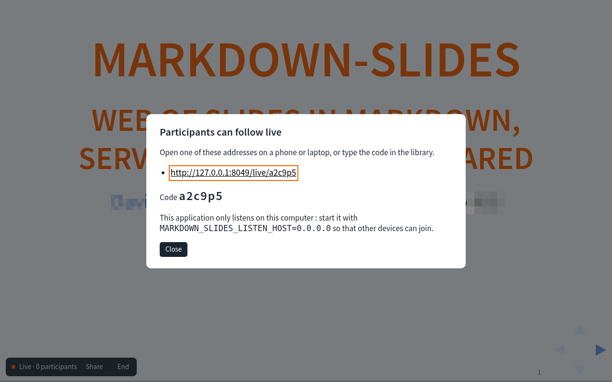<!-- .element: class="img" width="430px" --> 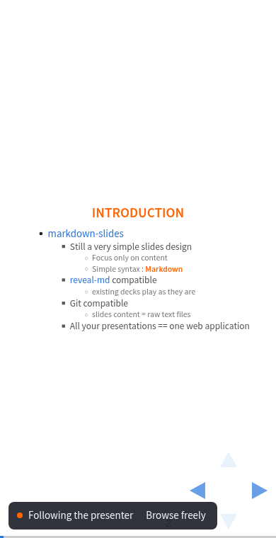<!-- .element: class="img" width="138px" -->

- `G` : a link and a 6 letters code to share
- participants follow the presenter on their devices
  + they may browse freely, then come back
- `make run-shared` to listen on the network

---

### PDF export

- On demand, from the library or the player
- Printed by the headless browser
  + exactly as shown, theme and diagrams included
  + every fragment shown
- Each slide is a bookmark

---

### look and feel

- Any reveal.js theme from the theme directories
  + plus built-in `white`, `black`, `orange-white` and `orange-black`
- Custom CSS over it, from the user interface
- A deck may choose its own :
  ```markdown
  ---
  theme: black
  ---
  ```

---

### Hello world slide

```markdown
Hello **world** and *universe* !
```

----

### Hello world slide rendering

Hello **world** and *universe* !

---

### Slides definition

- To separate slides horizontally use (empty line before and after 3 dashes without any space) :
  ```markdown
  current slide

  ---

  next right slide
  ```
- To separate slides vertically use 4 dashes `----`
- Within code blocks they are left alone :sparkles: 

----

### custom separators

```markdown
---
separator: <!--s-->
verticalSeparator: <!--v-->
---
first slide
<!--s-->
second slide
<!--v-->
below the second slide
```

---

### Plan

```markdown
- depth0
  - depth1
    - depth3
- first
  - second
    - third
```

----

### Plan rendering

- depth0
  - depth1
    - depth3
- first
  - second
    - third

---

### Multi-column plan

```markdown
- depth0
  - depth1
    - depth3
* first
  - second
    - third
```

----

### Multi-column Plan rendering

- depth0
  - depth1
    - depth3
* first
  - second
    - third

---

### two columns

```markdown
<div id="left">

#### column left

- blah blah left
  - truc muche left

</div>
<div id="right">

#### column right

- blah blah right
  - truc muche right

</div>
```

----

### two columns rendering

<div id="left">

#### column left

- blah blah left
  - truc muche left

</div>
<div id="right">

#### column right

- blah blah right
  - truc muche right

</div>

---

### line breaks

Two spaces at the end of a line = force a line break
```markdown
- Hello **world** !  
  Hello __world__!
```

----

### line breaks rendering

- Hello **world** !  
  Hello __world__!

---

### Headers

```markdown
# Header 1
## Header 2
### Header 3
#### Header 4
##### Header 5
```

----

### Headers rendering

# Header 1
## Header 2
### Header 3
#### Header 4
##### Header 5

---

### Anchors

- Headers content is used to produce anchors :
  + use lowercases
  + spaces become dashes, punctuation is dropped
- Examples :
  + for `# Title` use `title`
  + for `## My Wonderfull Title` use `my-wonderfull-title`

---

### links

```markdown
- external link
  + [google](https://www.google.com)
- inner link (anchors)
  + [introduction slide](#introduction)
  + [hello world slide](index.md#hello-world-slide)
- another presentation, at one of its slides :
  + [reveal-md links](../2024-02-reveals-md/index.md#links)
```

----

### links rendering

- external link
  + [google](https://www.google.com)
- inner link (anchors)
  + [introduction slide](#introduction)
  + [hello world slide](index.md#hello-world-slide)
- another presentation, at one of its slides :
  + `[reveal-md links](../2024-02-reveals-md/index.md#links)`

---

### code

````markdown
- code extract : `ls -la`
- or source code block with colorization :
  ```bash
  export TOTO=123
  echo $TOTO
  ```
````

----

### code rendering

- code extract : `ls -la`
- or source code block with colorization :
  ```bash
  export TOTO=123
  echo $TOTO
  ```

---

### highlighted lines :sparkles:

````markdown
```scala [2-3]
object Main extends ZIOAppDefault {
  def run =
    Console.printLine("Hello world")
}
```
````

----

### highlighted lines rendering

```scala [2-3]
object Main extends ZIOAppDefault {
  def run =
    Console.printLine("Hello world")
}
```

---

### terminal :sparkles:

````markdown
```terminal build
$ make test
[info] 17 tests passed
$ make run-jar
```
````

- `$ ` and `# ` prompts are highlighted

----

### terminal rendering

```terminal build
$ make test
[info] 17 tests passed
$ make run-jar
```

---

### Tables

```markdown
a  |b  |c  |d
---|---|---|---
1  |2  |3  |4
```

----

### Tables rendering

a  |b  |c  |d
---|---|---|---
1  |2  |3  |4

---

### images

```markdown

```

----

### images rendering


---

### images resizing

```
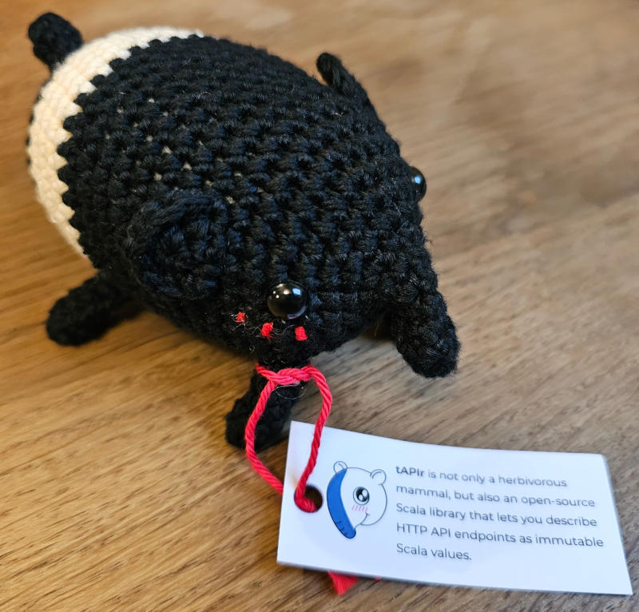<!--.element: class="img" width="400px" -->
<!--.element: class="img" width="200px" -->
<!--.element: class="img" width="100px" -->
<!--.element: class="img" width="50px" -->
```

----

### images resizing rendering

<!--.element: class="img" width="400px" -->
<!--.element: class="img" width="200px" -->
<!--.element: class="img" width="100px" -->
<!--.element: class="img" width="50px" -->

---

### animated images

```markdown

```

----

### animated images rendering


---

### SVG images

Use a `svg` code block, or the `svg` tag :

````markdown
```svg
<svg width="600" height="220" xmlns="http://www.w3.org/2000/svg">
  <rect x="10" y="10" width="580" height="200" rx="24" fill="#ff7900"/>
  <circle cx="110" cy="110" r="60" fill="#fff"/>
  <text x="360" y="125" text-anchor="middle" font-size="48"
        fill="#fff">markdown-slides</text>
</svg>
```
````

----

### SVG images rendering

```svg
<svg width="600" height="220" xmlns="http://www.w3.org/2000/svg">
  <rect x="10" y="10" width="580" height="200" rx="24" fill="#ff7900"/>
  <circle cx="110" cy="110" r="60" fill="#fff"/>
  <text x="360" y="125" text-anchor="middle" font-size="48"
        fill="#fff">markdown-slides</text>
</svg>
```

---

### simpler SVG images

- SVG are images !
  - Create a [LibreOffice Draw document](captures/example.odg)
    - Use the Export as `SVG` feature
  - Show the results using the image feature:
    ``

----

### simpler SVG images rendering

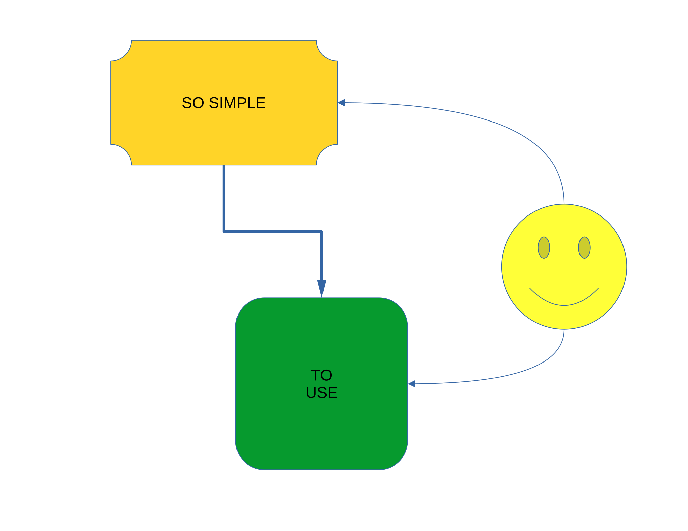<!-- .element: class="img" height="520px" -->

---

### maths :sparkles:

```markdown
Inline $e^{i\pi} + 1 = 0$ and display :

$$
\int_0^\infty e^{-x^2}\,dx = \frac{\sqrt{\pi}}{2}
$$
```

- [KaTeX](https://katex.org/) syntax, or a `math` code block

----

### maths rendering

Inline $e^{i\pi} + 1 = 0$ and display :

$$
\int_0^\infty e^{-x^2}\,dx = \frac{\sqrt{\pi}}{2}
$$

---

### callouts :sparkles:

```markdown
> [!TIP]
> Separators within code blocks are left alone

> [!WARNING]
> Also `[!NOTE]`, `[!IMPORTANT]` and `[!CAUTION]`
```

----

### callouts rendering

> [!TIP]
> Separators within code blocks are left alone

> [!WARNING]
> Also `[!NOTE]`, `[!IMPORTANT]` and `[!CAUTION]`

---

### marks and emojis :sparkles:

```markdown
- ==marked text== to catch the eye
- :rocket: :bulb: :warning: :white_check_mark: :coffee: :brain:
```

----

### marks and emojis rendering

- ==marked text== to catch the eye
- :rocket: :bulb: :warning: :white_check_mark: :coffee: :brain:

---

### iframe

```markdown
<iframe frameborder="0" width="100%" height="500pt"
     src="https://caniuse.com/cors/embed/description&links">
</iframe>
```

----

### iframe rendering

<iframe frameborder="0" width="100%" height="500pt"
     src="https://caniuse.com/cors/embed/description&links">
</iframe>

---

### youtube

```markdown
<iframe width="560" height="315"
  src="https://www.youtube.com/embed/61AGIBdG7YE"
  frameborder="0" allow="accelerometer; autoplay; encrypted-media; gyroscope; picture-in-picture"
  allowfullscreen>
</iframe>
```

----

### youtube rendering

<iframe width="560" height="315"
  src="https://www.youtube.com/embed/61AGIBdG7YE"
  frameborder="0" allow="accelerometer; autoplay; encrypted-media; gyroscope; picture-in-picture"
  allowfullscreen>
</iframe>

---

### lazy iframe

```markdown
<iframe frameborder="0" width="100%" height="500pt"
     data-src="https://caniuse.com/cors/embed/description&links">
</iframe>
```

- loaded only once its slide is shown

----

### lazy iframe rendering

<iframe frameborder="0" width="100%" height="500pt"
     data-src="https://caniuse.com/cors/embed/description&links">
</iframe>

---

### fragments

```markdown
- first<!-- .element: class="fragment" -->
- second<!-- .element: class="fragment" -->
- third<!-- .element: class="fragment" -->
- <!-- .element: class="fragment" -->
```

----

### fragments rendering

Press `space` several times :

- first<!-- .element: class="fragment" -->
- second<!-- .element: class="fragment" -->
- third<!-- .element: class="fragment" -->
- <!-- .element: class="fragment" width="300px" -->

---

### fragment styles :sparkles:

```markdown
- fade up<!-- .element: class="fragment fade-up" -->
- grow<!-- .element: class="fragment grow" -->
- highlight<!-- .element: class="fragment highlight-red" -->
- strike<!-- .element: class="fragment strike" -->
- together<!-- .element: class="fragment" data-fragment-index="9" -->
- at once<!-- .element: class="fragment" data-fragment-index="9" -->
```

----

### fragment styles rendering

- fade up<!-- .element: class="fragment fade-up" -->
- grow<!-- .element: class="fragment grow" -->
- highlight<!-- .element: class="fragment highlight-red" -->
- strike<!-- .element: class="fragment strike" -->
- together<!-- .element: class="fragment" data-fragment-index="9" -->
- at once<!-- .element: class="fragment" data-fragment-index="9" -->

---

### slide backgrounds :sparkles:

```markdown
<!-- .slide: data-background="#1c2430" -->

### On a dark background

Pictures, videos and frames too :
`data-background-image="captures/tapir.jpg"`
```

----

<!-- .slide: data-background="#1c2430" -->

### On a dark background

Pictures, videos and frames too :
`data-background-image="captures/tapir.jpg"`

----

<!-- .slide: data-background-image="captures/tapir.jpg" data-background-size="contain" -->

---

### tasks list

```markdown
- [ ] not done
- [x] done
- [ ] once again something todo
```

----

### tasks list rendering

- [ ] not done
- [x] done
- [ ] once again something todo

---

### Charts

- [mermaid](https://mermaid.js.org/) diagrams in a `mermaid` code block
- drawn in the browser, themed, printed in the PDF
- a syntax error shows the message instead of the chart

---

### pie chart

````markdown
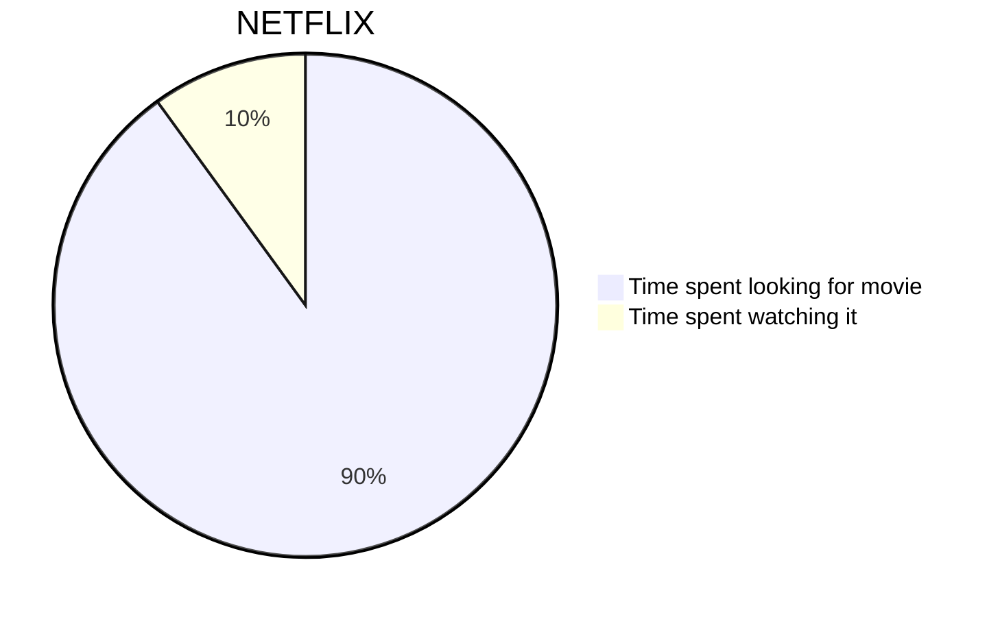
````

----

### pie chart rendering


---

### sequence diagram

````markdown
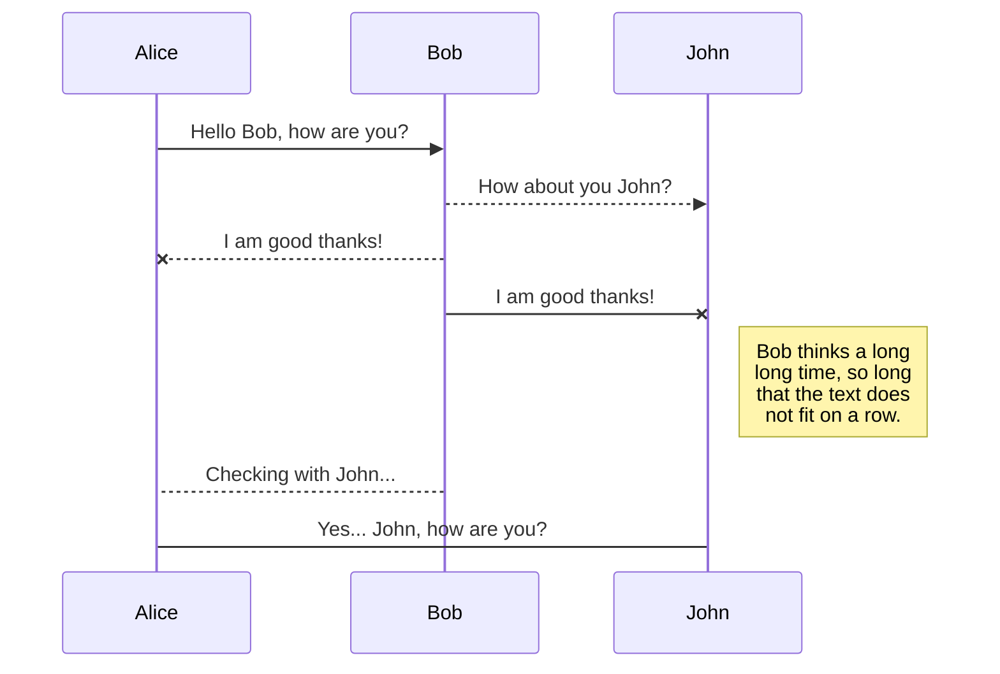
````

----

### sequence diagram rendering


---

### flowchart

````markdown
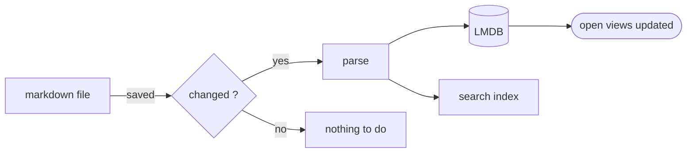
````

----

### flowchart rendering


---

### class diagram

````markdown
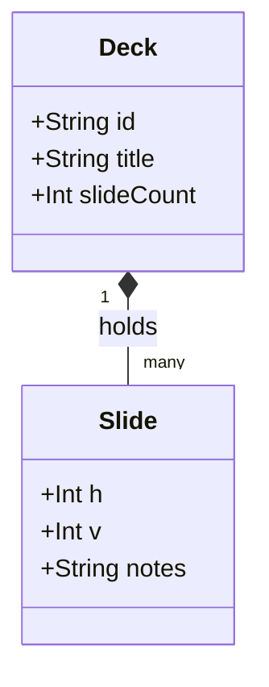
````

----

### class diagram rendering


---

### state diagram

````markdown
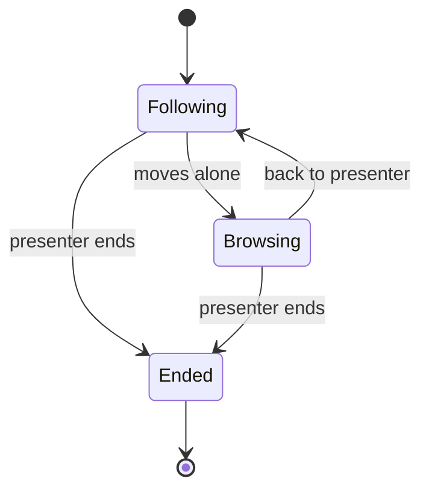
````

----

### state diagram rendering


---

### entity relationship

````markdown
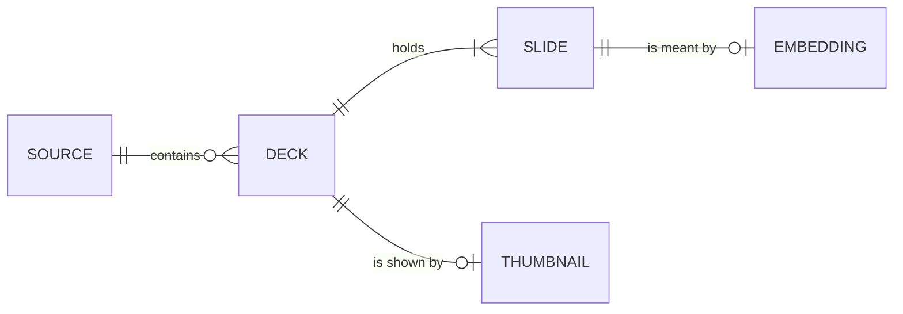
````

----

### entity relationship rendering


---

### gantt chart

````markdown
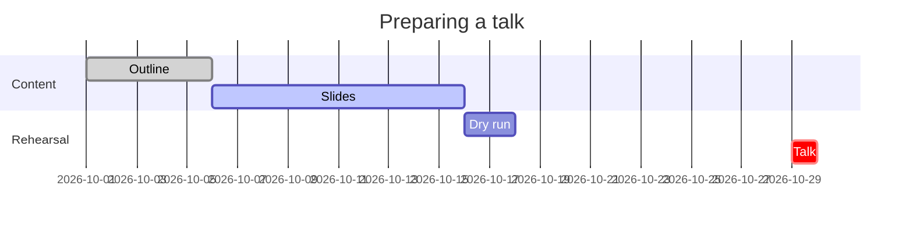
````

----

### gantt chart rendering


---

### mindmap

````markdown
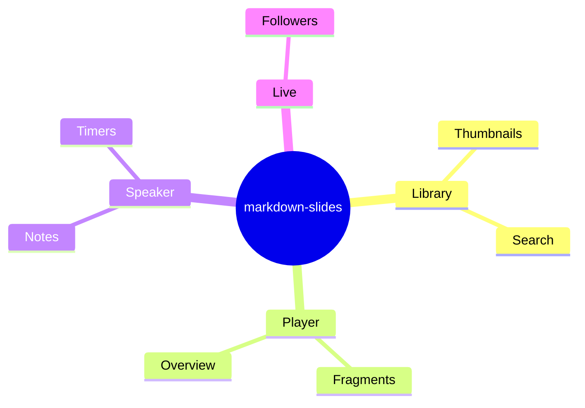
````

----

### mindmap rendering


---

### timeline

````markdown
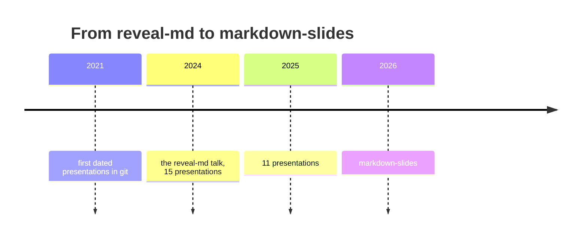
````

----

### timeline rendering


---

### git graph

````markdown
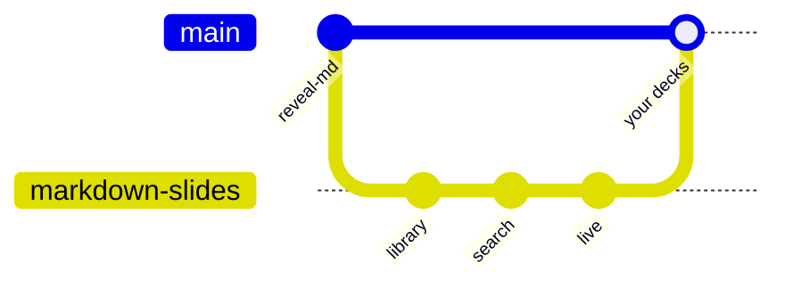
````

----

### git graph rendering

```mermaid
gitGraph
    commit id: "reveal-md"
    branch markdown-slides
    commit id: "library"
    commit id: "search"
    commit id: "live"
    checkout main
    merge markdown-slides id: "your decks"
```

---

### xy chart

````markdown
```mermaid
xychart-beta
    title "Presentations per year"
    x-axis [2016, 2017, 2018, 2019, 2020, 2021, 2022, 2023, 2024, 2025, 2026]
    y-axis "Presentations" 0 --> 16
    bar [5, 3, 4, 7, 8, 5, 2, 2, 15, 11, 4]
    line [5, 3, 4, 7, 8, 5, 2, 2, 15, 11, 4]
```
````

----

### xy chart rendering

```mermaid
xychart-beta
    title "Presentations per year"
    x-axis [2016, 2017, 2018, 2019, 2020, 2021, 2022, 2023, 2024, 2025, 2026]
    y-axis "Presentations" 0 --> 16
    bar [5, 3, 4, 7, 8, 5, 2, 2, 15, 11, 4]
    line [5, 3, 4, 7, 8, 5, 2, 2, 15, 11, 4]
```

---

### quadrant chart

````markdown
```mermaid
quadrantChart
    title Slides tools
    x-axis Hard to write --> Easy to write
    y-axis Static --> Live
    quadrant-1 Sweet spot
    quadrant-2 Powerful
    quadrant-3 Avoid
    quadrant-4 Simple
    markdown-slides: [0.85, 0.85]
    reveal-md: [0.8, 0.35]
    PowerPoint: [0.35, 0.5]
    LaTeX beamer: [0.15, 0.15]
```
````

----

### quadrant chart rendering

```mermaid
quadrantChart
    title Slides tools
    x-axis Hard to write --> Easy to write
    y-axis Static --> Live
    quadrant-1 Sweet spot
    quadrant-2 Powerful
    quadrant-3 Avoid
    quadrant-4 Simple
    markdown-slides: [0.85, 0.85]
    reveal-md: [0.8, 0.35]
    PowerPoint: [0.35, 0.5]
    LaTeX beamer: [0.15, 0.15]
```

---

### references

- https://github.com/dacr/markdown-slides
- https://github.com/dacr/zio-lmdb
- https://github.com/webpro/reveal-md
